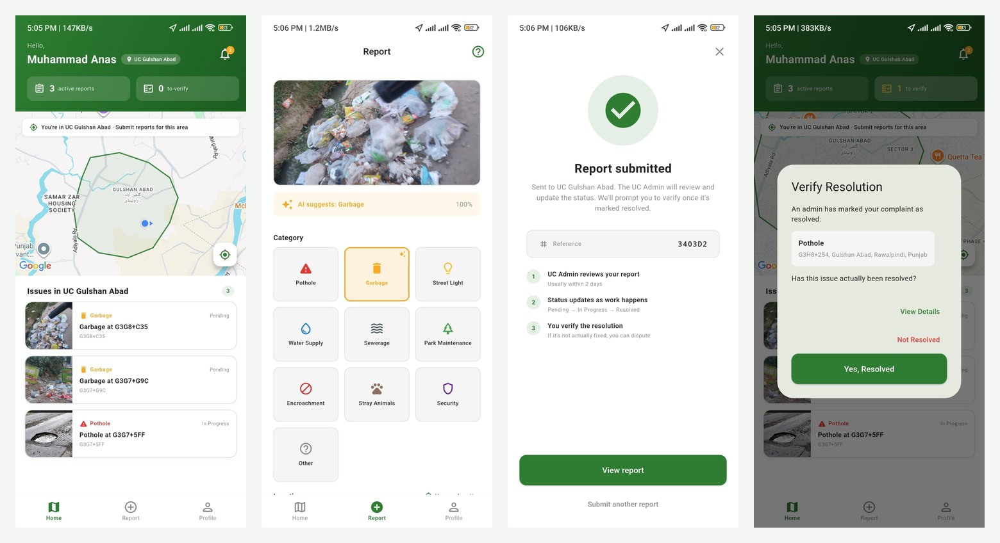
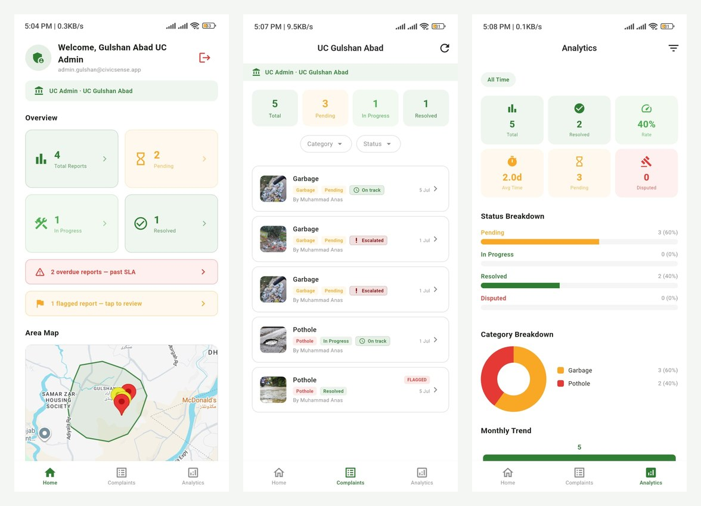
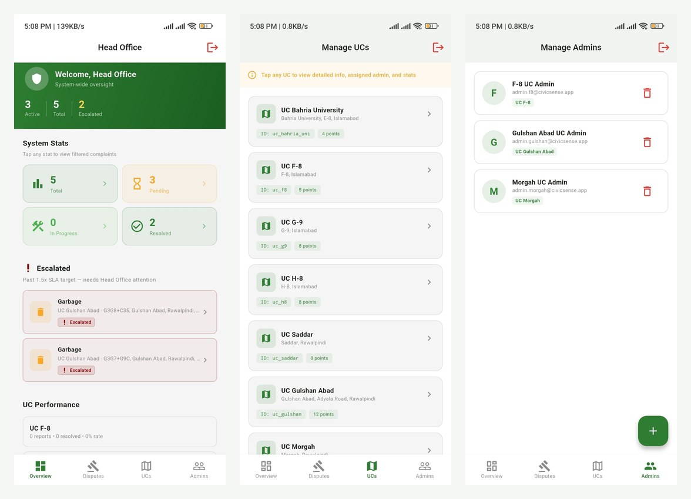

# CivicSense

**A mobile app that lets residents report civic problems like potholes and uncollected rubbish, and makes sure each complaint reaches the right local office and actually gets fixed.**

Final-year project, BS Computer Science, Bahria University Islamabad (2025–2026).
3rd place at the BUIC Open House.

🎥 **Demo video:** [watch here](ADD_YOUTUBE_LINK)

---

## The problem

In Pakistan, problems like potholes, overflowing garbage or broken streetlights often go unreported. When people do complain, the complaint can end up with the wrong office, and there's no easy way to know whether anything was done about it.

CivicSense fixes three things:
1. **Reporting is quick.** Take a photo, and the app suggests what the problem is.
2. **Complaints go to the right place.** Each report is sent to the Union Council (UC) responsible for that exact location.
3. **Nothing gets quietly ignored.** Every complaint has a deadline. Overdue ones are escalated to Head Office, and the resident confirms whether the issue was really fixed.

---

## How it works

The app has three types of users.

### 1. Residents

- The home screen shows a map of the resident's Union Council boundary and the open issues in their area.
- To report a problem, they take a photo and drop a pin on the map. **An on-device image model recognises potholes and garbage** and suggests the category, so they don't have to pick it themselves.
- Before the report is saved, the app checks for **possible duplicates** (an open complaint of the same type within 50 m in the last week) and asks the resident if it's the same issue.
- The report is sent to the UC responsible for that location, and the resident gets a reference number.
- When an admin marks the issue as resolved, the resident is asked to **confirm it's actually fixed**. If it isn't, they can dispute it.
- Each report shows **before and after photos** and a full status history.

### 2. UC Admins

- Each Union Council has its own admin who only sees complaints from their area.
- The dashboard highlights **overdue reports that have passed their deadline (SLA)** and **flagged reports** that need a personal check.
- Admins update the status (Pending → In Progress → Resolved) and upload an "after" photo as proof.
- An analytics page shows resolution rate, average time to resolve, and a breakdown by status and category.

### 3. Head Office

- Head Office sees the whole system: total, active, escalated and resolved complaints across all UCs.
- Complaints that go well past their deadline (1.5× the target time) are **automatically escalated** to Head Office.
- Head Office can compare how each UC is performing, manage the list of UCs and their map boundaries, and add or remove UC admins.

---

## Main features

- **AI category suggestion:** a MobileNetV2-based image model trained on our own dataset of local photos (about 92% accuracy). It recognises potholes and garbage, and runs on the phone with TensorFlow Lite so it works without internet.
- **Rejects irrelevant photos:** the model also has a "normal" class, so photos that don't show a civic problem aren't filed as complaints.
- **Duplicate detection:** catches repeat reports of the same issue (same type, within 50 m, last 7 days).
- **Location-based routing:** each UC is stored as one or more boundary polygons, and a point-in-polygon check sends every report to the UC it falls inside.
- **Deadlines and escalation:** each category has its own target time (water supply and sewerage 1 day, garbage 2 days, potholes 7 days, encroachment 30 days). Complaints are marked On track, Due soon, Overdue or Escalated, and go to Head Office once they pass 1.5× the target.
- **Resident verification and disputes:** an issue only counts as resolved once the person who reported it agrees.
- **Before and after photos** for every resolved complaint.
- **10 categories:** Pothole, Garbage, Street Light, Water Supply, Sewerage, Park Maintenance, Encroachment, Stray Animals, Security, Other.
- **Role-based access:** residents, UC admins and Head Office each see only what they're allowed to.

---

## Tech stack

| Part | Technology |
|---|---|
| Mobile app | Flutter (Dart) |
| Backend and real-time data | Firebase |
| Image model | Python, TensorFlow (MobileNetV2), converted to TensorFlow Lite for on-device use |
| Database and auth | Cloud Firestore, Firebase Authentication (email and Google sign-in) |
| Maps and location | Google Maps, Geolocator |

---

## My role

This was a team project. I was the **team lead and lead developer**. I split the work between team members, set our deadlines, ran our progress check-ins and made sure the app, the dataset and the model came together for the final demo. I also presented the project to the judges and to local housing societies.

---

## About the code

This repository is a **project showcase**. It includes screenshots, a demo video and three selected code files in [`code-samples/`](code-samples/): the on-device classifier, the UC routing and duplicate check, and the deadline and escalation rules.

The full source code is not public, but I'm happy to share it or walk through it on request.

---

## All screenshots

| Residents | UC Admin | Head Office |
|---|---|---|
| [Home and map](screenshots/1-resident/01-home-map.jpg) | [Dashboard](screenshots/2-uc-admin/01-dashboard.jpg) | [Overview and escalations](screenshots/3-head-office/01-overview-escalations.jpg) |
| [New report](screenshots/1-resident/02-new-report.jpg) | [Complaints list](screenshots/2-uc-admin/02-complaints-list.jpg) | [Manage UCs](screenshots/3-head-office/02-manage-ucs.jpg) |
| [AI category suggestion](screenshots/1-resident/03-ai-category-suggestion.jpg) | [Analytics](screenshots/2-uc-admin/03-analytics.jpg) | [Manage admins](screenshots/3-head-office/03-manage-admins.jpg) |
| [Report submitted](screenshots/1-resident/04-report-submitted.jpg) | | |
| [My reports](screenshots/1-resident/05-my-reports.jpg) | | |
| [Verify resolution](screenshots/1-resident/06-verify-resolution.jpg) | | |
| [Report details (before/after)](screenshots/1-resident/07-report-details-before-after.jpg) | | |

---

© 2026 Muhammad Anas. All rights reserved.
Contact: anasyounas2002@gmail.com · [LinkedIn](https://linkedin.com/in/muhammad-anas-2002ma)
